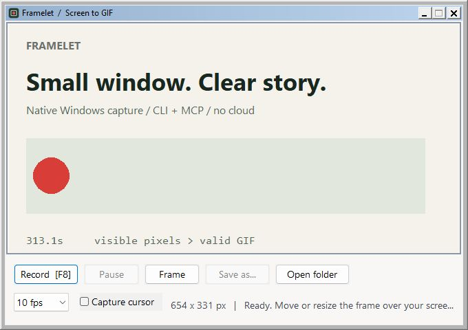
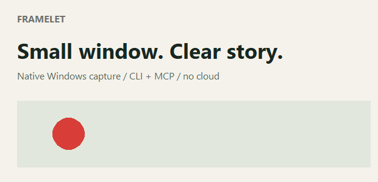

# Framelet

**CLI-first, AI-native Windows recording with keyboard, mouse and frame synchronization.**

**One small native EXE · No extra runtime installs · CLI First · AI Native**

[English](README.md) · [简体中文](README.zh-CN.md) · [Download](https://github.com/liuminxin45/framelet/releases) · [About](ABOUT.md)

Let an AI operate software while recording its screen and keyboard/mouse events, then query, extract and trim through MCP. **Built for AI-driven software tests, bug reproduction, product showcases and walkthroughs.** CLI and MCP are the primary interfaces; a native capture frame is also available. No Python, Node.js, .NET or FFmpeg installation is required.

## More than a GIF: an interaction timeline

Local development records **keyboard, mouse and frame samples together by default**, sharing UTC and monotonic clocks. A timeline and content-integrity manifest accompany the GIF.

- **Unique identities:** shared observation IDs link input events, original samples and GIF frames, with explicit timing offsets.
- **Input independent of FPS:** several actions between samples can map to one frame. Unsampled visual changes cannot be recovered.
- **Look up the action first:** query an event ID or timestamp, then inspect surrounding pictures instead of extracting every frame.

- **Computer time ↔ picture:** UTC timestamps and monotonic capture intervals connect original samples to GIF frames, even when identical pictures are merged.
- **Clicks, scrolling and pauses:** independent mouse events retain their timing at low recording FPS. Positional dwell candidates help identify where the pointer lingered.
- **Trim without losing context:** native trimming and speed changes preserve the original computer-time references and remap playback positions.
- **Useful to agents:** ask for clicks near a moment, locate a picture by computer time, then inspect the surrounding frames. Event data helps choose where to look before sending images to a model.

Keyboard records contain down/up transitions, key codes and scan codes, not clipboard or IME-committed text. Key events can reveal typed content; visual masks are not automatic password protection. Masked mouse coordinates are omitted. Timestamps describe observed intervals, not hardware synchronization; dwell candidates do not identify UI elements.

## Small tool, useful capabilities

| Capability | What it gives you |
| --- | --- |
| Native capture frame | Move, resize, record, pause and save; F8 control |
| CLI + local MCP | Background recording while an agent operates your app |
| [Reliable long recording](docs/long-recording.md) | Numbered GIFs of at most 300 seconds, automatic rotation and checkpoint recovery |
| Keyboard/mouse/frame timeline | Locate failed steps and review action results |
| 1–50 FPS | Stable-state checks through polished motion demos |
| GIF editing | Precise time cuts and playback speed changes |
| Native frame extraction | PNGs, contact sheets, timestamp probes and region comparisons |
| Privacy and guardrails | Fixed masks, scoped MCP paths, no-overwrite and resource limits |
| Isolation and integrity | Supervised capture process, content hashes and recovery markers |

Static acceptance can use **1 FPS**; compact GIFs **10–15 FPS**; polished demos default to **30 FPS**. Actual sampling depends on workload.

## What Framelet is for

Use Framelet to capture a short interface demonstration, preserve a visible state change, or let an AI agent inspect and trim a GIF through MCP. The recorder provides capture and image tools; the AI client or operator controls the application being demonstrated.

It captures visible desktop pixels on an interactive Windows x64 session. Overlapping windows can appear in the result. Direct MP4 export, audio recording, and hidden-window capture are outside the documented feature scope.

## Example 1 · Real window and recording

The original small real recording: **620×300 · 3 seconds · 16 FPS · 15,250 bytes**. This mostly static moving-marker scene is an example, not a general compression benchmark.

## Example 2 · Bilibili, operated and recorded through MCP

Start recording → scroll the real browser → stop → probe boundaries → trim idle time.

**29.88 seconds → 7.63 seconds.** Native region comparisons and interval jumps located boundaries with eight midpoint probes, avoiding intermediate image exports. [Read the real walkthrough](docs/demo.md).

The existing demos predate keyboard/mouse/frame synchronization. New local recordings produce timelines and integrity manifests; published v0.2 downloads do not yet include this feature.

For viewing GIFs and inspecting them frame by frame, we recommend [Minimal Image Viewer](https://github.com/deminimis/minimalimageviewer).

## Made for local workflows

Windows 10 2004+ / Windows 11 x64, visible desktop capture. No built-in cloud uploads or telemetry. GIF/PNG only; no audio or MP4. [Agent guide](docs/agent-guide.md) · [Timeline details](docs/timeline.md) · [Changelog](CHANGELOG.md).

By [Neo / 刘民心](https://liuminxin.cn). Inspired by GifCam, independently implemented. [MIT](LICENSE).
