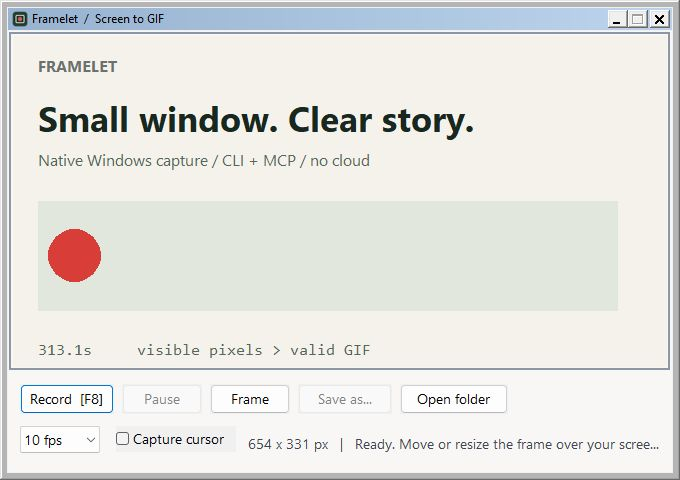
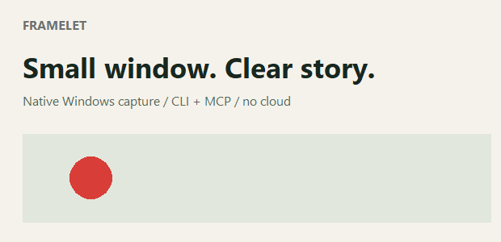
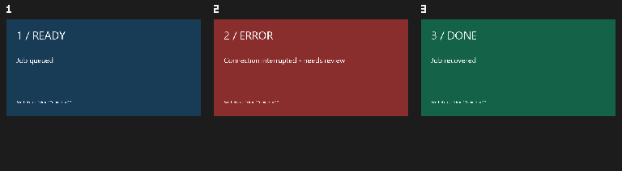

# Framelet

**小体积 · 无需额外运行时依赖 · AI 可通过 MCP 调用**

**Small binary. Zero extra runtime installs. Callable by AI through MCP.**

[English](README.md) | [简体中文](README.zh-CN.md)

[](https://github.com/liuminxin45/framelet/actions/workflows/ci.yml)
[](https://github.com/liuminxin45/framelet/releases/latest)
[](LICENSE)

Framelet 是用 Rust + Win32 编写的小型原生 Windows 录屏工具。最大的优势是**体积小、可独立运行：解压即用，也能被 AI 通过本地 MCP stdio 调用**。使用时无需安装 Python、Node.js、.NET、FFmpeg、浏览器运行时、模型 SDK，也不需要账号。

v0.1.0 EXE 约 **0.88 MiB**；带抽帧功能的开发版约 **1 MiB**。程序使用 Windows 自带接口和静态 CRT。构建工具、测试 SDK 仅供开发验证，不是使用便携版的前置条件。

## 下载

[**Windows x64 便携版 v0.1.0**](https://github.com/liuminxin45/framelet/releases/download/v0.1.0/framelet-v0.1.0-windows-x64.zip) · [所有版本](https://github.com/liuminxin45/framelet/releases) · [SHA-256 校验](https://github.com/liuminxin45/framelet/releases/download/v0.1.0/SHA256SUMS.txt)

需要 Windows 10 2004+ / Windows 11 x64 交互式桌面。解压后运行 `framelet.exe`，包内包含依赖许可证。

**版本区别：** v0.1.0 提供录屏与 7 个 MCP 工具；抽帧、MCP 图片预览位于 **main / 0.2.0-dev**，需从源码构建。已发布的 v0.1.0 附件保持原样。

## 真实窗口与实录



下方为实际录制结果：620×300、3 秒、16 FPS、48 帧、15,250 字节。画面是带移动标记的静态测试场景，不代表所有内容的压缩率。



## 原生窗口与 CLI

移动、缩放透明取景框；**Record / F8** 开始录制，再按一次完成保存。**Pause / Resume** 排除暂停时段；**Frame** 启动暂停的单帧会话或逐张追加；**Save as...** 把完成的 GIF 另存到新路径；**Open folder** 查看自动保存文件。

自动保存目录：`%LOCALAPPDATA%\Framelet\Captures`。录制区域固定；关闭录制中的窗口会先保存，再关闭一次退出。GUI 可选 10 / 16 / 20 / 25 FPS 和鼠标光标。

```powershell
.\framelet.exe
.\framelet.exe record --region 100,100,640,360 --duration 3 --fps 16 --cursor --output demo.gif
.\framelet.exe shot --region 100,100,640,360 --output shot.png
.\framelet.exe inspect demo.gif
.\framelet.exe edit demo.gif --start 0.5 --end 2 --speed 2 --output trimmed.gif
.\framelet.exe doctor
.\framelet.exe monitors
.\framelet.exe windows
.\framelet.exe record --duration 60 --session demo --events --output long.gif
# 从另一个进程提前停止并保存：
.\framelet.exe stop --session demo
```

坐标为物理像素，负坐标写作 `--region=-1920,0,1280,720`。不指定区域则捕获虚拟桌面，最高 16 MP。输出不能已存在，父目录需提前创建。捕获当前可见像素，遮挡和受保护内容遵循 Windows 行为。

CLI 帧率 1–50，时长 (0,3600] 秒，quality 为 1–30（1 最精细，30 最快）。Ctrl+C 会完成保存。相同画面合并延时，变化画面仅编码变化包围框，并持续写盘。stdout 返回 JSON 结果，`--events` 在 stderr 输出 JSONL 进度。操作错误退出 1 并返回 JSON，语法错误退出 2，帮助和版本为文本。

## AI 通过 MCP 调用

EXE 自身就是 MCP 服务，**无需另装服务运行时或配置模型 API Key**。启动 MCP 不会立即录屏，只有调用捕获工具才开始。

```powershell
codex mcp add framelet -- C:\Tools\Framelet\framelet.exe mcp
codex mcp get framelet --json
```

替换为自己的 EXE 绝对路径，注册或升级后重新启动 MCP 连接或客户端。长录屏时，在 Codex `config.toml` 的 `[mcp_servers.framelet]` 下设置 `tool_timeout_sec = 330`；单次 MCP 录屏为阻塞调用，最多 300 秒。

其他 stdio 客户端配置：

```json
{"mcpServers":{"framelet":{"command":"C:\\Tools\\Framelet\\framelet.exe","args":["mcp"]}}}
```

| 工具 | 作用 |
| --- | --- |
| `framelet_doctor`、`framelet_monitors`、`framelet_windows` | 就绪检查、显示器与窗口区域 |
| `framelet_record`、`framelet_shot` | GIF 录屏、PNG 截图 |
| `framelet_inspect`、`framelet_edit` | GIF 元信息、裁剪、变速 |
| `framelet_extract_frames`（main） | 候选 PNG、预览拼图、时间戳清单和上下文区间 |
| `framelet_read_image`（main） | 用 MCP 图片块查看一张 PNG |

main 中的截图和抽帧预览返回**真正的 MCP 图片块**及结构化结果，AI 可以直接看图；预览不超过 960px、1 MiB。`framelet schema` 输出版本化声明。程序不内嵌上传、执行 shell 或理解画面的云服务。

## 抽帧辅助 AI 选片段 — main / 0.2.0-dev

**GIF 原生解码，不依赖 FFmpeg 或额外运行时。** 导出前还原增量矩形、透明像素和帧处置模式，避免把局部变化误当完整画面。

```powershell
.\framelet.exe frames demo.gif --mode scene --count 8 --output frames
.\framelet.exe frames demo.gif --mode uniform --count 8 --output overview
```

新目录包含编号 PNG、`contact-sheet.png`、`manifest.json`，记录原始帧索引、时间戳、变化分数、选择原因和建议上下文区间。`--count` 是最多帧数，范围 1–64；多个均匀采样点命中同一帧会去重。scene 保留开场上下文，再选择超过 `--min-change`（默认 0.04）的变化帧；`--min-gap` 控制间隔（默认 0.5 秒），`--padding` 控制上下文（默认 0.75 秒）。

AI 流程：抽帧看预览 → 用 `framelet_read_image` 查看细节 → 判断哪个事件重要 → 用 `framelet_edit` 按秒指定 start/end 提取片段。**视觉变化不等于语义重要性**，建议区间也不是自动判定的“精彩片段”，仍由 AI 看图选择。当前抽帧输入只支持 **GIF**，尚未支持 MP4 等视频容器。



此图为合成兼容性测试用例：AI 看图后选择 1.0–2.2 秒的 ERROR 状态，再通过 MCP 导出包含上下文的 0.8–2.4 秒片段。它用于验证调用流程，不代表自动选片质量。

## 构建与验证

构建源码需要 Rust stable、MSVC C++ Build Tools 和 Windows SDK；使用便携 EXE 无需这些开发工具。

```powershell
git clone https://github.com/liuminxin45/framelet.git
cd framelet
cargo build --release --locked
cargo fmt --check
cargo clippy --all-targets --locked -- -D warnings
cargo test --locked
python -m pip install pillow
python scripts/verify.py target/release/framelet.exe --desktop
python scripts/verify_frames.py target/release/framelet.exe
# 官方 MCP SDK 仅为开发验证依赖：
npm install --prefix work/mcp-client @modelcontextprotocol/sdk@1.32.2 --ignore-scripts --no-audit --no-fund
node scripts/verify_mcp.mjs target/release/framelet.exe docs/images/framelet-demo.gif --desktop
powershell -ExecutionPolicy Bypass -File scripts/package.ps1
```

无交互式桌面的 CI 中省略 `--desktop`。尚未实现音频、AVI/MP4、可视时间轴、逐帧删除、叠加绘字、丰富调色和后台窗口捕获。GIF 编辑把透明像素落在黑色背景上。取景框默认排除在录屏之外；`FRAMELET_CAPTURE_UI=1` 仅用于截图 QA。

本项目受 [GifCam](https://www.bahraniapps.com/apps/gifcam/gifcam.php) 启发，代码独立实现，与原作者无隶属关系，不包含原程序、参考图标或反编译源码。见 [逆向记录](docs/research.md)、[实现设计](docs/design.md)、[变更记录](CHANGELOG.md)。MIT 许可，欢迎提交 [Issue](https://github.com/liuminxin45/framelet/issues) 或 Pull Request。
