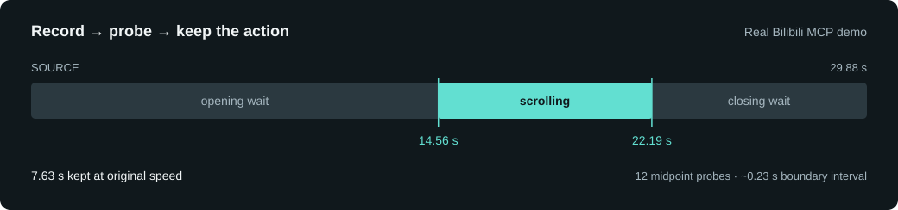
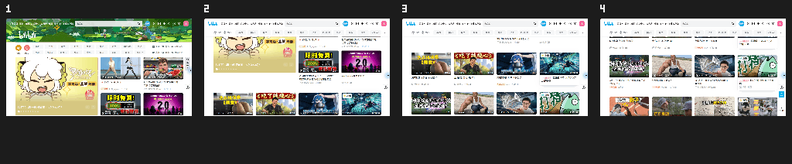

<div align="center">

# Framelet

**一个很小、AI 也能真正调用的 Windows 录屏工具。**<br>
**约 1.1 MiB · 无需额外运行时 · CLI First · MCP Native**

[English](README.md) · [简体中文](README.zh-CN.md)

[](#下载)
[](https://github.com/liuminxin45/framelet/releases/tag/v0.2.0-rc.1)
[](https://github.com/liuminxin45/framelet/actions/workflows/ci.yml)
[](LICENSE)

[**下载便携版**](https://github.com/liuminxin45/framelet/releases/download/v0.2.0-rc.1/framelet-v0.2.0-rc.1-windows-x64.zip) · [三步上手](#三步上手) · [MCP 配置](docs/mcp.md) · [真实演示](#示例一真实界面与演示)

</div>

Framelet 把 Windows 桌面上的一块可见区域录成 GIF，或截成 PNG。双击打开原生小取景框，也可以使用 CLI，或者让 AI 通过 **MCP stdio** 开始录制、停止、看图和裁剪。

最大的优势是**小，而且无需额外运行时依赖**：单个 EXE 约 **1.1 MiB**，解压即用。运行录屏工具无需安装 Python、Node.js、.NET、FFmpeg、浏览器运行时，也无需账号或模型 API Key。Rust + 原生 Windows API，静态 CRT，没有额外服务安装步骤。

## 示例一：真实界面与演示


保留最初的小演示：**620×300、3 秒、16 FPS、48 帧、15,250 字节**。它是 Framelet 实际录制的测试画面，展示静止背景与移动标记，不代表所有场景的压缩率。


## 下载

[**v0.2.0-rc.1 · Windows x64 便携 ZIP**](https://github.com/liuminxin45/framelet/releases/download/v0.2.0-rc.1/framelet-v0.2.0-rc.1-windows-x64.zip) · [SHA-256 校验](https://github.com/liuminxin45/framelet/releases/download/v0.2.0-rc.1/SHA256SUMS.txt) · [所有版本](https://github.com/liuminxin45/framelet/releases)

解压后运行 `framelet.exe`。需要 Windows 10 2004+ / Windows 11 x64 交互式桌面。本次为验收预览版，包含后台 MCP 会话、时间点取帧和防护增强；[v0.1.0](https://github.com/liuminxin45/framelet/releases/tag/v0.1.0) 稳定版保留。便携 ZIP 不到 1 MiB，演示媒体单独提供。构建和测试工具仅为开发依赖。

## 三步上手

```powershell
# ① 打开原生取景框：Record / F8、暂停、单帧、另存为
.\framelet.exe

# ② 录制一个区域：倒计时 2 秒，等比缩到 960px 宽
.\framelet.exe record --region 100,100,1280,720 --duration 15 --fps 12 --delay 2 --max-width 960 --output demo.gif

# ③ 留下有用片段，再导出 4 张 PNG 做教程或 PPT 素材
.\framelet.exe edit demo.gif --start 2 --end 8 --output clip.gif
.\framelet.exe frames clip.gif --mode uniform --count 4 --output slides
```

坐标是物理像素，可用 `monitors`、`windows` 查询。输出不能已存在，父目录需提前创建。录制的是当前可见桌面，其他窗口遮住时也可能被录进去。指定帧率是采样上限，实际速度取决于桌面和编码负载；GIF 延时按实际时间记录。

| 要做什么 | 可以直接使用的能力 |
| --- | --- |
| README / 自媒体配图 | 短 GIF、输出宽度控制、精确时间裁剪 |
| 工具 / 网页演示 | AI 操作页面时，MCP 在后台持续录制 |
| PPT / 操作教程 | 原分辨率 PNG、预览拼图、时间戳清单 |
| 更干净的演示 | 倒计时、暂停等待、变速、固定隐私遮挡 |

<details>
<summary>原生界面、快捷键与更多 CLI 用法</summary>

拖动或缩放取景框，透明区域可以直接点击。**Record / F8** 开始或完成录制；**Pause / Resume** 排除等待时间；**Frame** 启动暂停的单帧会话或追加一帧；**Save as...** 将成品复制到新路径，已有文件不可覆盖。自动保存位置：`%LOCALAPPDATA%\Framelet\Captures`。录制中固定取景区域；关闭先保存，再次关闭才退出。GUI 可选 10 / 16 / 20 / 25 FPS 和鼠标光标。倒计时、遮挡与缩放是 CLI/MCP 选项。

```powershell
.\framelet.exe doctor
.\framelet.exe monitors
.\framelet.exe windows
.\framelet.exe shot --region 100,100,640,360 --output shot.png
# 遮挡相对源区域左上角；可重复传 --mask
.\framelet.exe record --region 100,100,1280,720 --duration 15 --mask 1000,0,280,70 --max-width 960 --max-mib 64 --output private-demo.gif
.\framelet.exe record --duration 60 --session demo --events --output long.gif
# 从另一进程停止；CLI 的 Ctrl+C 也会完成保存
.\framelet.exe stop --session demo
```

负坐标示例：`--region=-1920,0,1280,720`。CLI 不传区域时录制虚拟桌面，受资源上限约束。CLI 时长 (0,3600] 秒，FPS 为 1–50，quality 为 1–30（1 最精细，30 最快）。stdout 输出 JSON，`--events` 在 stderr 输出 JSONL 进度；操作失败退出 1 并返回 JSON，语法错误退出 2，帮助和版本为文本。

</details>

## AI 通过 MCP 调用

**EXE 本身就是 MCP 服务。** AI 客户端按配置的绝对路径启动 `framelet.exe mcp`，无需手动启动另一个常驻服务。进程运行在要录制的 Windows 电脑上；连接 MCP 不会立即录屏。[中英文配置说明与全部 17 个工具 →](docs/mcp.md)

```json
{"mcpServers":{"framelet":{"command":"C:\\Tools\\Framelet\\framelet.exe","args":["mcp"]}}}
```

AI 先调用 `framelet_context`，便能知道 EXE、工作目录和输出位置，再按顺序调用：

```text
查询窗口 / 显示器 → start_recording → recording_status → 操作浏览器
                → stop_recording → frame_at / extract_frames → edit
```

start 返回 `session_id`。等状态为 `recording` 且已有采样，再操作页面。stop 保存，cancel 丢弃尚未完成的输出，pause 排除等待。截图和抽帧返回真正的 MCP 图片块，预览最大 960px / 1 MiB。浏览器由 AI 客户端操作，Framelet 提供录像和图像工具。

## 示例二：Codex 带你逛 Bilibili

[](docs/demo.md)

**真实浏览器，真实 MCP 调用，Framelet 原生导出的 GIF。** 29.88 秒 → 7.63 秒，960×505，30 帧 GIF，3.61 MiB。[静态预览](docs/images/bilibili-poster.png) · [实录与验证依据](docs/demo.md)

打开 [哔哩哔哩](https://www.bilibili.com/)，首页把音乐、知识、科技数码等内容入口放在一起。向下浏览推荐视频时，大幅页头逐渐让位于固定导航，视频卡片接着进入视野。一张截图难以讲清这个变化，几秒钟的录屏正合适。

这次演示由 Codex 通过 MCP 启动 Framelet，在 Edge 中滚动公开首页，再停止录制。随后用 **12 次中点探针，加 3 个锚点探针**定位动作边界，没有逐帧向模型展开原片的 137 张图。验证脚本用 PNG 固定区域差异辅助二分，AI 只展开 5 张边界图复核，最后保留原片 **14.56–22.19 秒**，按原速导出，并给动作首尾留了一点上下文。



这个二分示例适用于“单次向前滚动、开头和结尾页面位置稳定”的情况，不代表自动识别精彩片段。GIF 底层仍需顺序解码到目标位置，节省的是导出的图片和模型上下文，不保证解码计算量也为对数级。[完整中英文案例、原片和机器可读证据 →](docs/demo.md)

<details>
<summary>成片经 MCP 导出的 4 张 PNG 预览</summary>



本次抽帧返回 4 张原分辨率 PNG、这张拼图和时间戳清单；另通过 `framelet_read_image` 验证了图片读取。

</details>

## 少看图，也能找到片段

[给 Agent 的高效剪辑指引 →](docs/agent-guide.md)，`framelet_context` 也会返回这套流程。

推荐方法是**稳定区域差分＋按播放时间二分＋帧区间缓存**。`framelet_frame_at` 可与锚点 PNG 比较，传 `include_image:false` 只返回差异数值；再省略 `output`，便不写中间 PNG。在同一段 Bilibili 原片上，区间跳跃把中点请求从 **12 次降到 8 次**，数值搜索期间只返回 **2 张锚点图片**；最后仍需看边界图复核。[原生接口复测记录](docs/demos/bilibili-native-bisection.json)


```powershell
# 取一个时间点；对于已知静止→动作区间，继续取中点缩小范围
.\framelet.exe frame-at demo.gif --at 4.5 --output midpoint.png

# 不熟悉录像内容时，也可以先取一张小型预览拼图
.\framelet.exe frames demo.gif --mode scene --count 6 --output review
```

`framelet_frame_at` 返回指定播放时间所在的完整画面、帧号和精确时间区间。`framelet_extract_frames` 导出合成后的 PNG、拼图、时间戳和上下文建议区间。uniform 按时间采样，scene 按视觉变化排序。**视觉变化不等于语义重要性**，内容是否值得保留仍需 AI 看图判断。目前输入只支持 GIF。

## 防误操作与异常防护

- **明确捕获目标：** MCP 必须指定区域或 `full_screen:true`，连接时不录制。固定矩形遮挡先于缩放和编码，不会自动识别或追踪秘密。
- **限制录制会话：** 每个 MCP 服务只允许一个活动录制；最长 300 秒，暂停也计入上限，倒计时另计。EOF 取消未完成的后台录像；对已完成会话重复 stop/cancel 不会删除成品。
- **保护已有文件：** 不覆盖，GIF/PNG 原子发布；MCP 读写目录受配置约束，拦截路径穿越、设备/网络路径，正常异常会清理本会话临时文件。这是本地防误操作机制，不能代替操作系统沙箱。
- **检查资源和协议：** 像素、吞吐、文件大小、GIF 解码工作量均有限制；格式错误或过大的请求不会破坏后续请求。不内置上传、遥测、shell 执行或音频采集。

[详细上限、失败行为与配置 →](docs/mcp.md)。GDI 录制可见像素，安全桌面、受保护内容、HDR 管理和后台窗口捕获不在已验证范围。尚未内置 MP4/音频导出、可视时间轴或绘字；GIF 编辑把透明像素落在黑色背景上。

## 构建与验证

源码构建需要 Rust stable、MSVC C++ Build Tools 和 Windows SDK；运行便携 EXE 无需安装这些工具。

```powershell
cargo build --release --locked
cargo fmt --check
cargo clippy --all-targets --locked -- -D warnings
cargo test --locked
python -m pip install pillow
python scripts/verify.py target/release/framelet.exe --desktop
python scripts/verify_frames.py target/release/framelet.exe
python scripts/verify_robustness.py target/release/framelet.exe --desktop
npm install --prefix work/mcp-client @modelcontextprotocol/sdk@1.32.2 --ignore-scripts --no-audit --no-fund
node scripts/verify_mcp.mjs target/release/framelet.exe --desktop
powershell -ExecutionPolicy Bypass -File scripts/package.ps1
```

无交互式桌面的 CI 省略 `--desktop`。Pillow 和官方 MCP SDK 是独立开发校验器，不是录屏软件的运行时依赖。[实现设计](docs/design.md) · [变更记录](CHANGELOG.md) · [反馈问题](https://github.com/liuminxin45/framelet/issues)

作者：[Neo / 刘民心](https://liuminxin.cn)。本项目受 [GifCam](https://www.bahraniapps.com/apps/gifcam/gifcam.php) 启发，代码独立实现，与原作者无隶属关系，不包含参考程序、图标或反编译源码。[研究记录](docs/research.md) · [关于](ABOUT.md) · MIT 开源。
