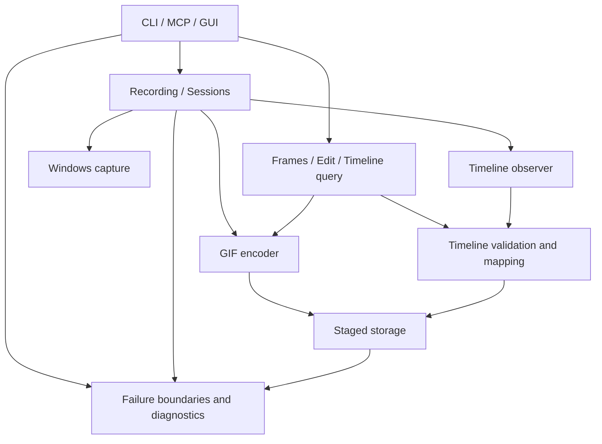

# Architecture / 架构与依赖边界

## Reliable rotating recordings / 可靠轮转录制

`series/args.rs` validates the explicit long-recording contract; `model.rs` defines group/segment/checkpoint identities; `store.rs` owns naming, bounded indexes, leases and discovery; `engine.rs` owns continuous observation, writer rotation, reserved budgets and one asynchronous finalizer; `recovery.rs` validates dead owners, committed receipts and hash-bound checkpoint prefixes; `review.rs` produces bounded group overviews. CLI and MCP adapters call these services through the existing supervised worker. GUI and single-GIF capture use the same current supervised core. [Operation and limits](long-recording.md).

Each part is independently playable and committed. recording.json is an atomically replaced, backed-up index; segment.json receipts can rebuild it. Checkpoints are bounded full snapshots every approximately five seconds, not an unbounded in-memory session or a promise of crash-free native APIs. Shared session/observation IDs survive rotations; asset/frame identity is per part. Recovery never fabricates missing observations or retries application input.

## Current synchronization and isolation layer / 当前同步与隔离层

- `worker.rs` supervises explicit recordings in an isolated child of the same EXE. A kill-on-close Windows job owns the child; the child waits for its request until after job assignment. Heartbeat, stop and wall-clock deadlines turn a failed/hung worker into a structured host failure. CLI, MCP and GUI now use the same recording lifecycle, including manual single-frame requests.
- `identity.rs` supplies native Windows random IDs and streaming SHA-256, with no extra runtime installation. Original session/observation identities survive edits; each output asset has its own identity.
- `file_guard.rs` pins ancestor directories without delete sharing and opens input files without write/delete sharing or reparse traversal. An operation keeps these leases while it reads/writes. `storage.rs` publishes through a source file handle with no-overwrite rename, removing the hard-link requirement.
- `transaction.rs` creates pending markers and a final hash-bound capture manifest. Explicit recovery validates both files and checks that the prior owner exited. Missing frames/events are reported, not recreated.
- Operational logs have per-process names to avoid concurrent rotation, a 1 MiB rotation threshold and owned-file retention. They never include the input event stream or request body.

Keyboard and mouse share one bounded event queue and observation-ID allocator; IDs, timestamps and explicit offsets connect them to frame samples.

```text
src/
  main.rs                 startup and final failure boundary
  cli.rs                  CLI parsing, named stop handle and JSON output
  gui.rs                  Win32 capture frame, UI state and worker adapter
  mcp/
    catalog.rs            tool declarations only
    dispatch.rs           argument/path validation and tool execution
    mod.rs                bounded JSON-RPC framing and request error boundary
  recording/
    options.rs            shared recording request model
    services.rs           screenshot and doctor application services
    mod.rs                recording loop, timing, pause/stop and masks
  sessions.rs             bounded background recording lifecycle
  capture.rs              Win32/GDI capture and desktop inventory
  encode.rs               GIF streaming/editing and PNG encoding
  frames.rs               bounded compositing, extraction and probes
  timeline/
    model.rs              serializable samples/events and limits
    recorder.rs           Windows mouse observer and timestamp collection
    store.rs              sidecar publication and strict input validation
    query.rs              bounded event/time/dwell queries
    mapping.rs            native trim/speed playback remapping
    tests.rs              mapping/privacy/dwell tests
  safety.rs               MCP root/path policy and context discovery
  storage.rs              staged files, no-overwrite publication and copying
  runtime.rs              task failure boundaries and rotating diagnostics
```

Adapters (CLI, MCP, GUI) call application/core services. Core recording and session modules do not depend on CLI definitions. Timeline models do not depend on native hooks. Recorder, query, storage and mapping are independently reviewable. GIF serialization stays in encode; sidecar storage validates against its frame inventory.



## Failure contract / 失败处理约定

- Expected failures use Result internally. CLI returns nonzero and structured JSON; MCP returns isError plus structuredContent.failure, preserving the server for a subsequent request. GUI displays worker/operation failures and logs them locally.
- Release uses unwind. Catch unexpected Rust panics at task boundaries, not inside a partially mutated operation. Workers terminate with a failure; an independent next request can run. FFI callbacks contain unwinding before returning to Windows. A GUI reentrancy guard prevents nested callbacks accessing App state while an outer callback may hold a mutable reference. System close commands post WM_CLOSE asynchronously so the guard does not swallow Alt+F4. Completed recordings restore keyboard focus.
- Failure records contain code, stage, message (bounded), unix_ms, retryable (conservatively false), and log_error if persistence itself fails. Logs are local under %LOCALAPPDATA%/Framelet/Logs, use per-process names, rotate at 1 MiB with one previous file and retain owned log files. They do not include request bodies, screenshots or input-event streams. Error text can contain local paths.
- Stage writes before publishing. Publication uses a handle-based no-overwrite rename under pinned directory leases. A cleanup failure after publication is a warning, not a false claim that the output was lost. PNG and GUI Save As share the staged-file primitive. GIF retains its streaming writer transaction; its publication follows the same rule.
- GIF and timeline remain separate file transactions. Preserve a successfully published GIF if optional metadata fails; report incomplete metadata and warn. Do not blindly retry a partially committed operation. Inspect returned paths/warnings first.
- Mouse startup and shutdown waits are bounded. A native thread that cannot stop in time is detached with its own Arc-owned data; warnings identify incomplete trace data. Windows API calls themselves are not forcibly interruptible.

All changes must follow [the engineering standard](engineering-standard.md). Only timeline schema 2 is read; there is no schema-1 reader, inferred interval or asset-ID fallback. MCP exposes 20 current tools; recording always uses asynchronous sessions. Stop/cancel returns immediately, the first terminal intent wins, and disconnect preserves an already accepted stop. Process identity belongs to identity.rs and uses PID plus creation time for both single and group recovery. Recovery validates candidate media/timeline before publication and safely resumes after media, timeline, manifest or receipt publication.

## Boundaries that remain / 仍然存在的边界

No promise of recovery from process termination, power loss, allocator abort/OOM, stack overflow, native access violations or corrupt OS state. Logging can fail when storage is unavailable; the structured response exposes that failure. These are local guardrails, not a security sandbox or audit-grade input recorder. No automatic fallback to an insecure/broader capture region or automatic retry of clicks is performed.

GUI manual single-frame requests now pass through the same supervised recording engine as CLI/MCP. The UI adapter translates its buttons into pause, resume, stop and single-frame control messages.

`framelet_context.recovery_discovery` checks up to 512 root entries and returns at most 16 pending captures, with an explicit truncation flag. This discovers interrupted work on the default agent entry path without starting recording or deleting files.
