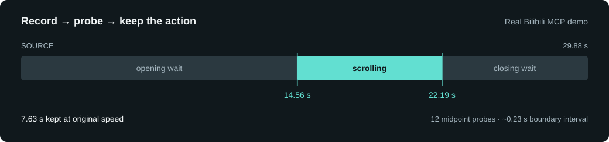

# A real Bilibili walkthrough · Bilibili 真实演示

[English README](../README.md) · [中文 README](../README.zh-CN.md)


## From a homepage to a useful clip

On [Bilibili's public homepage](https://www.bilibili.com/), music, knowledge, technology and other categories sit above a feed of video recommendations. Scroll down and the large illustrated header gives way to compact fixed navigation. That transition is exactly the kind of detail a short recording explains better than a still screenshot.

Codex used Framelet's **actual stdio MCP server**, called through the official TypeScript MCP SDK 1.32.2. It started a background recording, confirmed that samples were arriving, operated Edge through native desktop tools, then stopped and saved the GIF. The selected take used 48 small downward scroll actions; the page was public and signed out. No generated website mockup or synthetic animation was substituted for the recording.

The recording included waiting before and after the scroll. To remove it, timestamp probes bisected the opening and closing boundaries. Three anchors and twelve midpoint probes exported **15 point images from a 137-frame source**. Independent PNG region comparisons guided the decisions; the AI expanded five boundary images for visual review. The native editor then retained **14.56–22.19 seconds**, at original speed, including a little context around the action. A final MCP extraction produced four full-resolution PNGs, a contact sheet and a timestamp manifest.

## 从 B 站首页，到一段可复用的演示素材

打开 [哔哩哔哩的公开首页](https://www.bilibili.com/)，音乐、知识、科技数码等内容入口位于推荐视频上方。向下浏览时，大幅插画页头逐渐让位于固定导航，视频卡片进入视野。这个变化用几秒钟录屏来介绍，比一张静态截图直观。

这段画面由 Codex 调用 Framelet **真正的 MCP stdio 服务**录制，调用端使用官方 TypeScript MCP SDK 1.32.2：先开启后台录制，确认已经产生采样，再通过原生桌面工具控制 Edge，分 48 个小步向下滚动，最后停止并保存。页面处于未登录状态，画面没有用生成的网页模型或合成动画替代。

原片包含操作前后的等待。后处理采用二分时间点探针：3 个锚点加 12 次中点取帧，共从 137 帧原片导出 **15 张点位图**；独立 PNG 固定区域差异辅助选择，AI 展开其中 5 张边界图复核。随后由 Framelet 原生编辑器按原速保留 **14.56–22.19 秒**，给滚动首尾留出少量上下文。最后再次通过 MCP 导出 4 张原分辨率 PNG、拼图和时间戳清单。



| Evidence / 验证项 | Result / 结果 |
| --- | --- |
| Source recording / 原片 | 29.88 s · 137 encoded frames · 4,678,343 bytes |
| Capture / 录制 | GDI · source 1860×980 physical pixels · output 960×505 |
| Requested sampling / 请求采样 | Up to 12 fps; actual throughput varies / 上限 12 fps，实际速度随负载变化 |
| Boundary interval / 边界定位区间 | <0.234 s each / 首尾各小于 0.234 秒 |
| Kept clip / 成片 | 7.63 s · 30 GIF frames · 3,783,927 bytes · speed 1× |
| Independent verification / 独立校验 | Pillow decoded duration, frame count and every retained image against the source / 核对时长、帧数与保留画面 |
| GIF re-quantization / GIF 重新量化 | Maximum mean RGB channel error 1.0201 / 单帧最大平均 RGB 通道误差 1.0201 |

[**Raw recording / 下载原片**](https://github.com/liuminxin45/framelet/releases/download/v0.2.0-rc.1/bilibili-slow-raw.gif) · [Native GIF / 原生 GIF 成片](images/bilibili-demo.gif) · [Static preview / 静态预览](images/bilibili-poster.png)

<details>
<summary>Four extracted frames / 4 张抽帧预览</summary>


The four selected frames begin at 0, 2.50, 5.00 and 7.43 seconds in the finished clip. The final one covers the closing playback interval. Full PNGs and the manifest are included in the release evidence archive.

4 张选定画面分别从成片的 0、2.50、5.00、7.43 秒开始；最后一张覆盖结尾播放区间。原分辨率 PNG 与清单位于 Release 的验证资料包中。

</details>

## Reproduce the MCP workflow / 复现调用顺序

Use a new output root and adjust coordinates for your screen. Framelet records visible pixels; the AI host's UI tools perform the scrolling. These are `tools/call` names and arguments, not shell commands.

使用新的输出目录，并按自己的屏幕调整坐标。Framelet 录制可见像素，滚动由 AI 客户端的桌面工具完成。以下为 MCP `tools/call` 的工具名和参数，不是 shell 命令。

```json
{"name":"framelet_context","arguments":{}}
{"name":"framelet_start_recording","arguments":{"output":"raw.gif","region":{"x":42,"y":40,"width":1860,"height":980},"duration":90,"fps":12,"max_width":960,"quality":15,"max_mib":64}}
{"name":"framelet_recording_status","arguments":{"session_id":"<returned-session-id>"}}
```

Wait for `recording` and at least one sample, operate the browser, then:

等待状态为 `recording` 且至少已有一次采样，操作浏览器后调用：

```json
{"name":"framelet_stop_recording","arguments":{"session_id":"<returned-session-id>"}}
{"name":"framelet_inspect","arguments":{"input":"raw.gif"}}
{"name":"framelet_frame_at","arguments":{"input":"raw.gif","at":14.94,"output":"midpoint.png"}}
{"name":"framelet_edit","arguments":{"input":"raw.gif","start":14.56,"end":22.19,"speed":1,"output":"clip.gif"}}
{"name":"framelet_extract_frames","arguments":{"input":"clip.gif","mode":"uniform","count":4,"output":"frames"}}
{"name":"framelet_read_image","arguments":{"input":"frames/contact-sheet.png"}}
```

The exact trim times belong to this recording. For another recording, first establish a static/action bracket, probe its midpoint and halve the bracket until it is narrow enough. The same procedure finds when the final page position has settled. Stable page regions help ignore carousel or thumbnail animation.

裁剪时间仅适用于本次原片。换一段录像时，先找到静止与动作之间的区间，取中点、判断、缩小一半，直到足够精确；结尾则查找页面进入最终稳定位置的时刻。选择稳定的页面区域，有助于避开轮播图和缩略图动画的干扰。

**Limits:** this recipe assumes one forward scroll and stable endpoints. It is not a general detector for multiple actions, camera motion or semantic highlights. A GIF has no general random-access frame index: each point probe decodes a prefix. Bisection limits exported/model-visible images; it does not promise logarithmic decoder work. Pillow comparisons are independent development verification, not a dependency installed with Framelet.

**边界：** 此示例假设单次向前滚动且首尾位置稳定，不能直接当作多动作、镜头运动或语义精彩片段检测器。GIF 不能普遍随机访问目标帧，每个探针仍需解码前缀；二分减少的是导出和模型可见的图片，不保证底层解码计算量也为对数级。Pillow 对比属于独立开发验证，不是 Framelet 的运行时依赖。

## What the recording taught us / 这次实录带来的算法改进

The original cut used plain midpoint probes. Framelet now computes stable-region differences natively and can return numerical results without an image block or PNG export. Reusing each returned frame interval reduced midpoint calls on the same source from **12 to 8**: 3 for the opening and 5 for the closing boundary, with 171/211 ms intervals. The native replay returned two anchor images; every midpoint was numerical. Independent Pillow comparisons exactly matched all native numerical results. [Agent workflow](agent-guide.md) · [Native replay](demos/bilibili-native-bisection.json)

最初裁剪采用普通中点探针；项目现已内置稳定区域数值差分，可不发送图片、不导出中间 PNG。利用每次返回的帧覆盖区间，在同一原片上将中点请求从 **12 次降到 8 次**：开头 3 次、结尾 5 次，定位区间为 171/211 ms。原生复测仅返回 2 张锚点图，中间均为数值；所有原生差分结果与独立 Pillow 像素核对完全一致。[给 Agent 的操作流程](agent-guide.md) · [原生复测记录](demos/bilibili-native-bisection.json)

## Inspect the evidence / 核验依据

- [Bisection points, regions and decisions / 二分点位、比较区域和选择记录](demos/bilibili-bisection.json)
- [Dimensions, timing, hashes and independent decode / 尺寸、时长、散列与独立解码](demos/bilibili-verification.json)
- [Actual MCP call trace, with local paths normalized / 真实 MCP 调用轨迹，本地路径已转为相对路径](demos/bilibili-mcp-trace.json)
- [Release evidence archive / Release 验证资料包](https://github.com/liuminxin45/framelet/releases/download/v0.2.0-rc.1/bilibili-mcp-evidence.zip)

The page's video thumbnails and trademarks belong to their respective owners. Bilibili is the public demonstration target; this project is independently developed by [Neo / 刘民心](https://liuminxin.cn).

页面视频缩略图及商标归各自权利人。Bilibili 为公开演示对象；本项目由 [Neo / 刘民心](https://liuminxin.cn) 独立开发。

README presentation references: [eSearch](https://github.com/xushengfeng/eSearch) for visible use cases and demos; [RustDesk](https://github.com/rustdesk/rustdesk) for language navigation and prominent download paths. The recordings, layout and copy here were made for Framelet.

README 展示方式参考了 [eSearch](https://github.com/xushengfeng/eSearch) 的场景演示、[RustDesk](https://github.com/rustdesk/rustdesk) 的语言导航与下载入口；本文、布局和实录素材为 Framelet 单独制作。
